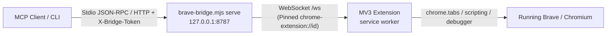

# AniEvo Brave Bridge

[](https://github.com/AniEvo-ID/anievo-brave-bridge/actions/workflows/ci.yml)
[](https://www.npmjs.com/package/anievo-brave-bridge)
[](https://github.com/AniEvo-ID/anievo-brave-bridge/releases)
[](LICENSE)

> **Language:** **English** | [Bahasa Indonesia](README.md)

Control a **running Brave (or any Chromium) browser** **without closing or relaunching** it with `--remote-debugging-port`. Your active sessions, cookies, extensions, and open tabs stay completely intact.

Built for **AI coding agents** (Google Antigravity, Claude Code, Gemini CLI, Cursor, etc.) so they can open pages, read the DOM, click, fill React/contentEditable inputs, handle JS dialogs, emulate mobile viewports, capture console/network traffic, and take screenshots or vector PDFs in your real browser.

- 🧩 **Zero dependencies** — MV3 extension + pure Node.js (`>= 18`) CLI & MCP server
- 🔒 **Hardened security** — `127.0.0.1` only, `X-Bridge-Token` auth, zero CORS, Host header validation, and pinned `chrome-extension://<id>` Origin
- 🗂️ **Isolated agent tab groups** — agent tabs open inside `"Antigravity"` (or `"Antigravity-<session>"` for parallel multi-agent runs); user tabs are protected by an automatic guard
- 🫥 **Zero focus stealing** — new tabs, trusted CDP clicks/keys, mobile emulation, screenshots, and PDFs all run in **background tabs** while you keep working in your own tab
- 🤖 **Built-in MCP server & Antigravity Plugin** — **33 `browser_*` MCP tools** + ready-to-install `plugin.json` bundle
- 🎛️ **Toolbar Popup UI** — inspect live connection status, active agent tab groups, and close all agent tabs in one click

---

## Architecture



The extension **never opens a listening port** — it connects outbound over WebSocket to `127.0.0.1:8787`, so you load it once and never need to restart your browser.

---

## Quick Start

### Option 1 — Install as an Antigravity Plugin (All-in-One)

Clone directly into your global Antigravity plugins folder to get the **MCP server + `brave-bridge` skill + tab-group safety rules** in one unit:

```bash
git clone https://github.com/AniEvo-ID/anievo-brave-bridge.git ~/.gemini/config/plugins/anievo-brave-bridge
```

Then load the browser extension once in `brave://extensions` (**Developer mode** → **Load unpacked** → select the `brave-extension/` subfolder).

### Option 2 — Via npm / npx (Zero Clone)

```bash
npx anievo-brave-bridge extension-path    # extracts brave-extension/ to ~/.brave-bridge/brave-extension
npx anievo-brave-bridge serve             # starts the local bridge server
```

Load the printed `~/.brave-bridge/brave-extension` folder once in `brave://extensions` (**Developer mode** → **Load unpacked**).

### Option 3 — Standalone Git Clone

```bash
git clone https://github.com/AniEvo-ID/anievo-brave-bridge.git ~/.brave-bridge
cd ~/.brave-bridge

# 1. Start the local bridge server (generates config.json with a random secret token on first run)
node brave-bridge.mjs serve

# 2. Load brave-extension/ as an unpacked extension in brave://extensions (badge turns green "ON")
curl -s http://127.0.0.1:8787/health

# 3. (Optional) Auto-start on login — supports Windows Startup, macOS launchd, and Linux systemd --user
node brave-bridge.mjs install-autostart
```

---

## AI Agent Integration (MCP Server — 33 Tools)

AniEvo Brave Bridge ships a built-in zero-dependency stdio MCP server exposing **33 `browser_*` tools**. If the local bridge server is not running yet, the MCP server starts it automatically in the background.

> 💡 **Quick tip:** Click the **AniEvo Brave Bridge** toolbar icon in Brave → **Copy MCP Config (JSON)**, or run `npx anievo-brave-bridge mcp-config`.

```json
{
  "mcpServers": {
    "brave-bridge": {
      "command": "npx",
      "args": ["-y", "anievo-brave-bridge", "mcp"]
    }
  }
}
```

Or using a local clone: `"command": "node", "args": ["/path/to/anievo-brave-bridge/brave-bridge.mjs", "mcp"]` (pass `"--auto-session"` when running multiple parallel MCP agent processes).

- **Claude Code:** `claude mcp add brave-bridge -- npx -y anievo-brave-bridge mcp`
- **Antigravity:** `~/.gemini/config/mcp_config.json` (or install as an all-in-one plugin above)
- **Cursor / Windsurf / Cline / DeepSeek Harness:** paste `mcpServers` into your MCP config
- **Gemini CLI:** `~/.gemini/settings.json` → `mcpServers`

| Category | MCP Tools |
|---|---|
| **Tabs & Sessions** | `browser_open` (`session` supported), `browser_navigate`, `browser_tabs`, `browser_close_tab`, `browser_close_group` |
| **Inspection** | `browser_snapshot` (`@1`, `@2` refs), `browser_text`, `browser_html`, `browser_links`, `browser_forms`, `browser_frames` |
| **Interaction** | `browser_click` (left/right/double), `browser_drag`, `browser_fill`, `browser_type`, `browser_select`, `browser_check`, `browser_press_key`, `browser_hover`, `browser_scroll`, `browser_upload`, `browser_dialog`, `browser_eval` |
| **State & Responsive** | `browser_cookies` (`HttpOnly` included), `browser_storage` (`local`/`session`), `browser_emulate` (`iphone`/`pixel`/`ipad`/`desktop` + dark/light) |
| **Wait & Capture** | `browser_wait_for`, `browser_screenshot` (returns image directly to model), `browser_pdf`, `browser_capture`, `browser_console`, `browser_network`, `browser_status` |

---

## CLI Reference

```bash
node brave-bridge.mjs <command> [args] [--flags]
```

| Category | Commands |
|---|---|
| **Info** | `status`, `tabs [--group "Name"] [--session id] [--all-sessions]`, `active`, `frames`, `url`, `title`, `window` |
| **Tabs** | `new [url]`, `open <url>`, `goto <url> --new`, `goto <url> --tabId N`, `close [tabId]`, `activate <tabId>`, `reload [--hard]`, `back`, `forward`, `close-group ["Name"] [--all-sessions]` |
| **Read & Eval** | `snapshot [--viewport] [--max N]`, `text [sel] [--max N]`, `html [sel]`, `links`, `forms`, `count <sel>`, `attr <sel> <name>`, `eval "<js>"`, `eval --file x.js`, `eval -` |
| **Interact** | `click [--double] [--button right]`, `dblclick`, `rightclick`, `drag <from> <to>`, `hover`, `focus [--clear]`, `fill`, `type`, `select`, `check`, `uncheck`, `key <Combo> [sel]`, `scroll`, `upload <sel> <file…>`, `dialog once-accept\|accept\|dismiss\|off\|status [prompt]` |
| **State & Emulate** | `cookies [list \| set <k> <v> [--http-only] \| delete <k> \| clear]`, `storage [list \| get <k> \| set <k> <v> \| remove <k> \| clear] [--session-storage]`, `emulate iphone\|pixel\|ipad\|desktop\|reset [--color-scheme dark\|light]` |
| **Wait & Media** | `wait <ms>`, `waitFor <sel> [--gone]`, `waitFor --text "…"`, `waitUrl <substr\|/regex/>`, `shot [--selector sel] [--full] [--jpeg] [--out file]`, `pdf [--landscape] [--out file.pdf]` |
| **Debug & Ops** | `serve`, `mcp [--auto-session]`, `mcp-config`, `extension-path`, `capture start\|stop\|status`, `console [--level error]`, `net [--filter s] [--failed] [--body <id>]`, `reload-ext`, `install-autostart`, `uninstall-autostart` |

**Selectors:** Standard CSS (automatically pierces open Shadow DOM), `@N` refs from `snapshot`, `text=Save`, explicit shadow piercing `my-card >>> button`, and `--frame all|N` for iframes.

---

## Security Model

| Layer | Protection |
|---|---|
| **Loopback & DNS** | Listens strictly on `127.0.0.1` and validates the `Host` header against DNS-rebinding attacks |
| **CLI Auth** | `/cmd` requires `X-Bridge-Token` (`config.json`, verified with `crypto.timingSafeEqual`) |
| **Web Isolation** | Zero CORS headers; any request carrying an `http(s)` `Origin` header is immediately rejected (`403`) |
| **Extension Pinning** | `/ws` only accepts `chrome-extension://<id>` and pins the extension ID on first connection |
| **Tab & Session Guard** | Mutating commands targeting user tabs outside `"Antigravity*"` (or another agent's `--session` group) are rejected unless `--force` is passed; cookies are scoped strictly to the target tab's URL |

---

## Testing

```bash
npm test
```

Runs the zero-dependency `node:test` suite against an isolated browser profile (`--user-data-dir` in temp, never touches your running profile), covering server security boundaries, DOM/Shadow DOM/iframe automation, CDP trusted input, dialog handling, cookies/storage, responsive emulation, PDF export, per-session isolation, and the MCP server. Tested continuously on **Ubuntu (Xvfb)** and **Windows (`--headless=new`)** in GitHub Actions.

---

## License

[MIT](LICENSE) © 2026 AniEvo-ID
