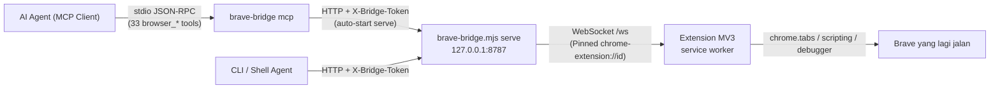

# AniEvo Brave Bridge

[](https://github.com/AniEvo-ID/anievo-brave-bridge/actions/workflows/ci.yml)
[](https://www.npmjs.com/package/anievo-brave-bridge)
[](https://github.com/AniEvo-ID/anievo-brave-bridge/releases)
[](LICENSE)

> **Bahasa:** **Bahasa Indonesia** | [English](README.en.md)

Kontrol browser **Brave (atau Chromium apa pun)** yang **lagi jalan**, tanpa perlu close atau relaunch pakai `--remote-debugging-port`. Sesi login, cookie, dan tab lu tetap utuh.

Dibuat buat **AI coding agent** (Antigravity, Claude Code, Gemini CLI, dll.) supaya bisa buka halaman, baca DOM, klik, isi form, screenshot, sampai capture console/network di browser asli lu, cukup lewat satu CLI.

- 🧩 Extension MV3 + CLI Node.js **tanpa dependency** (Node ≥ 18)
- 🔒 Cuma localhost, pakai token auth, dan Origin extension di-pin
- 🗂️ Tab buatan agent otomatis masuk tab group sendiri (mendukung **isolasi tab group per sesi** untuk multi-agent paralel), dan tab milik user dilindungi guard
- 🫥 **Nggak nyolong fokus**: tab agent dibuka dan dikerjain di background (klik, isi form, input trusted, screenshot), jadi lu tetap stay di tab lu
- 🛠️ Mode CDP opsional via `chrome.debugger` (tetap tanpa relaunch)
- 🤖 **MCP server & Antigravity Plugin** bawaan: 33 tool `browser_*` + `plugin.json` siap pasang di Antigravity / Claude Code / Gemini CLI
- 🎛️ **Popup UI di toolbar Brave**: lihat status koneksi live, daftar tab group agent aktif, dan tombol *Close All Agent Tabs* sekali klik

---

## Arsitektur



Extension **nggak buka port**. Dia yang konek keluar lewat WebSocket ke server lokal, jadi cukup di-load sekali dan Brave nggak perlu ditutup lagi.

---

## Instalasi

### Via npm / npx (paling cepat)

```bash
npx anievo-brave-bridge extension-path    # ekstrak extension ke ~/.brave-bridge/brave-extension
npx anievo-brave-bridge serve             # jalankan server bridge
```

### Atau via Git clone

```bash
git clone https://github.com/AniEvo-ID/anievo-brave-bridge.git ~/.brave-bridge
cd ~/.brave-bridge
```

1. **Jalankan server** (yang pertama kali akan membuat `config.json` berisi token rahasia):
   ```bash
   node brave-bridge.mjs serve
   ```
2. **Load extension** di Brave: buka `brave://extensions` → nyalakan **Developer mode** → **Load unpacked** → pilih folder `brave-extension/`.
3. Badge extension berubah jadi **ON** (hijau). Cek koneksi:
   ```bash
   curl -s http://127.0.0.1:8787/health     # "ext": true
   node brave-bridge.mjs status
   ```
4. *(Opsional)* jalan otomatis tiap login (**Windows** Startup, **macOS** `launchd` LaunchAgent, **Linux** `systemd --user`):
   ```bash
   node brave-bridge.mjs install-autostart   # hapus: uninstall-autostart
   ```
   Log server ditulis ke `server.log`.

> [!NOTE]
> Waktu extension pertama kali konek, ID-nya otomatis **di-pin** di `config.json`. Kalau lu pindah folder extension (ID-nya jadi beda), jalankan `serve --reset-ext`.

---

## MCP Server (33 Tool `browser_*`) & Integrasi AI Agent

AniEvo Brave Bridge sudah membawa **MCP Server stdio zero-dependency** bawaan (**33 tool `browser_*`**) sehingga AI agent (Antigravity, Claude Code, Cursor, Windsurf, Cline, DeepSeek, Gemini CLI) bisa mengontrol Brave secara native tanpa lewat shell. Kalau server bridge lokal belum jalan, proses MCP **otomatis menyalakannya di background**.

> 💡 **Tips cepat:** Klik icon **AniEvo Brave Bridge** di toolbar Brave → klik tombol **Copy MCP Config (JSON)**, atau jalankan `node brave-bridge.mjs mcp-config`.

### 1. Pasang via `npx` (Tanpa Clone Manual)

Tambahkan ke konfigurasi MCP client lu (`mcp_config.json` / `claude_desktop_config.json` / `.cursor/mcp.json`):

```json
{
  "mcpServers": {
    "brave-bridge": {
      "command": "npx",
      "args": ["-y", "anievo-brave-bridge", "mcp"]
    }
  }
}
```

### 2. Pasang dari Clone Lokal (`~/.brave-bridge`)

```json
{
  "mcpServers": {
    "brave-bridge": {
      "command": "node",
      "args": ["C:\\Users\\<User>\\.brave-bridge\\brave-bridge.mjs", "mcp"]
    }
  }
}
```

### 3. Shortcut per Platform AI Agent

- **Google Antigravity (Plugin All-in-One — MCP + Skill + Rules):**
  ```bash
  git clone https://github.com/AniEvo-ID/anievo-brave-bridge.git ~/.gemini/config/plugins/anievo-brave-bridge
  ```
- **Claude Code:**
  ```bash
  claude mcp add brave-bridge -- npx -y anievo-brave-bridge mcp
  ```
- **Cursor / Windsurf / Cline / Roo / DeepSeek Harness:** tempel JSON `mcpServers` di atas ke pengaturan MCP.
- **Gemini CLI:** tempel blok `mcpServers` di atas ke `~/.gemini/settings.json`.

*(Untuk multi-terminal / multi-agent paralel di mana tiap proses MCP butuh tab group terpisah otomatis, tambahkan `"--auto-session"` di akhir `args`).*

### Daftar Lengkap 33 Tool MCP

| Grup | Tool MCP |
|---|---|
| **Tab & Sesi (6)** | `browser_status`, `browser_tabs` (`group`/`session`/`allSessions`), `browser_open` (`url`, `session`), `browser_navigate` (`url`/`back`/`forward`/`reload`), `browser_close_tab`, `browser_close_group` |
| **Inspeksi DOM (6)** | `browser_snapshot` (menghasilkan ref `@1`, `@2`, …), `browser_text`, `browser_html`, `browser_links`, `browser_forms` (password disensor), `browser_frames` |
| **Interaksi & JS (12)** | `browser_click` (left/right/double + `trusted`), `browser_drag`, `browser_fill` (React & contentEditable aman), `browser_type`, `browser_select`, `browser_check`, `browser_press_key`, `browser_hover`, `browser_scroll`, `browser_upload`, `browser_dialog` (anti-freeze `alert`/`confirm`/`prompt`), `browser_eval` (`await` + auto-bypass CSP) |
| **State & Emulasi (3)** | `browser_cookies` (termasuk `HttpOnly`, dibatasi ke origin tab agent), `browser_storage` (`local`/`session`), `browser_emulate` (`iphone`/`pixel`/`ipad`/`desktop`/`reset` + `dark`/`light`) |
| **Visual & Debug (6)** | `browser_wait_for` (selector / teks / regex URL / `gone`), `browser_screenshot` (kirim gambar langsung ke model), `browser_pdf` (vektor PDF), `browser_capture` (`start`/`stop`), `browser_console`, `browser_network` (termasuk `responseBodyOf`) |

Alur standar agent: `browser_open` → `browser_snapshot` → interaksi pakai ref `@N` → `browser_screenshot` → `browser_close_group`.

---

## Pemakaian CLI (Standalone / Fallback Non-MCP)

```bash
node brave-bridge.mjs <command> [args] [--flags]
```

### Alur kerja tipikal (agent)

```bash
node brave-bridge.mjs new https://example.com          # tab baru -> group "Antigravity" (ungu)
node brave-bridge.mjs snapshot --tabId 123             # daftar elemen interaktif + ref @N
node brave-bridge.mjs fill @2 "halo@contoh.com" --tabId 123
node brave-bridge.mjs click @5 --tabId 123
node brave-bridge.mjs waitFor --text "Berhasil" --tabId 123
node brave-bridge.mjs shot --tabId 123
node brave-bridge.mjs close-group                      # tutup semua tab group "Antigravity"
```

### Daftar command

| Kategori | Command |
|---|---|
| **Info** | `status`, `tabs [--group "Nama"]`, `active`, `frames`, `url`, `title`, `window [--state …]` |
| **Tab** | `new [url]`, `open <url>`, `goto <url> --new`, `goto <url> --tabId N`, `close [tabId]`, `activate <tabId>`, `reload [--hard]`, `back`, `forward`, `close-group ["Nama"]`, `mine`, `close-mine` |
| **Baca** | `snapshot [--viewport] [--max N]`, `text [sel] [--max N]`, `html [sel]`, `links`, `forms`, `count <sel>`, `attr <sel> <name>` |
| **Eval** | `eval "<js>"`, `eval --file x.js`, `eval -` (stdin), opsi `--isolated`, `--cdp`, `--no-cdp` |
| **Interaksi** | `click [--double] [--button right]`, `dblclick`, `rightclick`, `drag <asal> <tujuan>`, `hover`, `focus [--clear]`, `fill`, `type`, `select`, `check`, `uncheck`, `key <Combo> [sel]`, `scroll [top\|bottom\|+N\|-N\|sel]`, `upload <sel> <file…>`, `dialog accept\|dismiss\|once-accept\|auto-accept\|off\|status` |
| **Cookies/Storage** | `cookies [list \| set <k> <v> [--http-only] \| delete <k> \| clear]`, `storage [list \| get <k> \| set <k> <v> \| remove <k> \| clear] [--session-storage]` |
| **Tunggu** | `wait <ms>`, `waitFor <sel> [--gone]`, `waitFor --text "…"`, `waitUrl <substr\|/regex/>` |
| **Screenshot, PDF & Emulasi** | `shot [--selector sel] [--full] [--jpeg] [--quality 80] [--out file]`, `pdf [--landscape] [--no-bg] [--out file.pdf]`, `emulate iphone\|pixel\|ipad\|desktop\|reset [--color-scheme dark\|light]` |
| **Console/Network** | `capture start\|stop\|status`, `console [--level error] [--last N] [--clear] [--all]`, `net [--filter s] [--failed] [--body <id>]` |
| **Maintenance & MCP** | `serve`, `mcp [--auto-session]`, `mcp-config`, `extension-path`, `reload-ext`, `install-autostart`, `uninstall-autostart`, `help` |

**Flag global:** `--tabId N`, `--session <id>`, `--timeout ms`, `--json`, `--frame N|all`, `--force`, `--no-group`, `--foreground`, `--activate`, `--all-sessions`

### Isolasi tab group per sesi (multi-agent paralel)

Kalau beberapa agent jalan barengan (mis. swarm / subagent / beberapa terminal), kasih ID sesi supaya `close-group` satu agent nggak ikut nutup tab agent lain:

```bash
# CLI (atau set env BRAVE_BRIDGE_SESSION=worker-1)
node brave-bridge.mjs new https://example.com --session worker-1   # -> group "Antigravity-worker-1"
node brave-bridge.mjs close-group --session worker-1               # cuma nutup group sesi worker-1
node brave-bridge.mjs close-group --all-sessions                   # bersihin semua group sesi sekaligus
```

- Tiap sesi otomatis dapet warna tab group sendiri dan dilindungi **cross-session guard** (sesi `worker-1` ditolak kalau nyoba ngubah tab milik `worker-2`).
- Di MCP: kirim parameter `session: "worker-1"` di `browser_open` / `browser_close_group`, atau jalankan `node mcp.mjs --auto-session` (env `BRAVE_BRIDGE_AUTO_SESSION=1`) supaya tiap proses MCP punya ID sesi unik otomatis.

### Kerja di background (fokus user aman)

Tab baru **selalu dibuka di background** dan semua command jalan tanpa ngaktifin tab itu. Ini termasuk input trusted `--cdp` dan screenshot, bahkan waktu window Brave lagi di-minimize. Jadi lu bisa tetap kerja di tab lu sendiri sementara agent jalan di tab group-nya.

| Mau | Pakai |
|---|---|
| Tab baru langsung aktif | `new <url> --foreground` |
| Aktifkan tab agent sebentar lalu balikin fokus (buat situs yang butuh tab kelihatan) | `--activate` (di `shot`, `click/key/type/hover --cdp`) |
| Pindah ke tab secara permanen | `activate <tabId>` |

> [!NOTE]
> Halaman di tab background bisa kena throttling timer dari browser (`setInterval` jadi minimal sekitar 1 detik). `waitFor` tetap responsif karena pakai `MutationObserver`.

### Selector

| Bentuk | Contoh | Keterangan |
|---|---|---|
| CSS | `button.primary` | Otomatis cari juga ke dalam **open shadow root** |
| Ref snapshot | `@12` | Dari output `snapshot` |
| Teks | `text=Simpan` | Ambil elemen terkecil yang kelihatan, lalu naik ke elemen interaktif terdekat |
| Shadow eksplisit | `my-card >>> button` | Tembus shadow DOM bertingkat |
| Iframe | `--frame all` / `--frame 3` | Lihat ID frame dengan `frames` |

---

## Mode CDP (opsional)

Kalau ditambah `--cdp` (atau lewat `capture`, `upload`, `shot --full`, dan fallback `eval` di halaman yang CSP-nya ketat), extension nempel ke tab lewat `chrome.debugger`. **Tetap tanpa relaunch.** Yang jadi bisa:

- **Input trusted** (`event.isTrusted === true`): `click --cdp`, `key --cdp`, `type --cdp`. Jalan juga di tab background, karena debugger di-attach dulu sebelum koordinat dihitung dan pakai focus emulation.
- `eval` yang tembus CSP (`Runtime.evaluate`), termasuk top-level `await`
- Capture console dan network, plus isi response (`net --body`)
- Upload file ke `<input type="file">`
- Screenshot full page

> [!WARNING]
> Selama debugger nempel, Brave nampilin bar *"… started debugging this browser"*. Bar ini otomatis hilang begitu perintahnya selesai, kecuali kalau lagi `capture start` (hilang setelah `capture stop`).

---

## Keamanan

Bridge ini bisa ngejalanin JavaScript di tab mana pun, jadi pengamanannya dibikin ketat:

| Lapisan | Perlindungan |
|---|---|
| Jaringan | Server cuma listen di `127.0.0.1`, dan Host header dicek (anti DNS-rebinding) |
| Auth CLI | `/cmd` wajib header `X-Bridge-Token` (dari `config.json`, dibandingkan dengan timing-safe compare) |
| Website | **Tanpa header CORS.** Request yang bawa Origin `http(s)` langsung ditolak (403), jadi halaman web nggak bisa ngontrol bridge |
| Extension | WebSocket cuma nerima Origin `chrome-extension://<id>` yang udah di-pin |
| Job | ID acak (UUID) + `expiresAt`, jadi perintah yang udah timeout nggak bakal dieksekusi belakangan |
| Tab user | **Guard**: aksi yang ngubah tab (klik, isi, navigasi, eval, …) ditolak kalau tab-nya di luar group default, kecuali pakai `--force`. Perintah baca tetap boleh |

> [!CAUTION]
> Jangan commit atau share `config.json`, karena isinya token. File ini udah masuk `.gitignore`.

### Konfigurasi (`config.json`)

```json
{
  "token": "…dibuat otomatis…",
  "defaultGroup": "Antigravity",
  "defaultColor": "purple",
  "guard": true,
  "extId": "…di-pin otomatis…"
}
```

Environment variable: `BRAVE_BRIDGE_PORT` (default `8787`), `BRAVE_BRIDGE_TIMEOUT` (default `45000` ms), `BRAVE_CDP_ARTIFACTS` (folder screenshot, default `~/.brave-cdp/artifacts`).

---

## Batasan

- Nggak bisa inject ke halaman internal (`brave://`, `chrome://`, Chrome Web Store).
- Shortcut native browser (mis. `Ctrl+T`) nggak bisa dipicu, termasuk lewat `--cdp`.
- `shot` di tab aktif pakai `captureVisibleTab` (tanpa debugger). Di tab background dan `--full` pakai CDP, jadi bar "debugging" sempat muncul sebentar.
- `--cdp click` belum mendukung elemen di dalam iframe.
- Kalau DevTools lagi kebuka di tab yang sama, attach debugger bisa gagal.

---

## Testing & CI

Test suite otomatis (`node:test`, tetap tanpa dependency eksternal) menguji batas keamanan server, alur E2E extension di Chromium terisolasi (`--user-data-dir` terpisah, tidak menyentuh profil browser utama), isolasi tab group per sesi, dan protokol MCP:

```bash
npm test
```

Setiap push dan Pull Request otomatis diuji di GitHub Actions pada **Ubuntu (Xvfb)** dan **Windows (`--headless=new`)** menggunakan Chrome for Testing.

---

## Lisensi

[MIT](LICENSE) © 2026 AniEvo-ID
