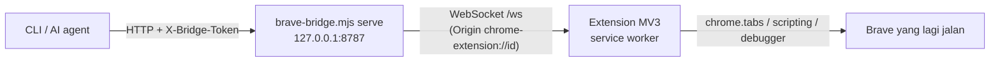

# AniEvo Brave Bridge

Kontrol browser **Brave (atau Chromium apa pun)** yang **lagi jalan**, tanpa perlu close atau relaunch pakai `--remote-debugging-port`. Sesi login, cookie, dan tab lu tetap utuh.

Dibuat buat **AI coding agent** (Antigravity, Claude Code, Gemini CLI, dll.) supaya bisa buka halaman, baca DOM, klik, isi form, screenshot, sampai capture console/network di browser asli lu, cukup lewat satu CLI.

- 🧩 Extension MV3 + CLI Node.js **tanpa dependency** (Node ≥ 18)
- 🔒 Cuma localhost, pakai token auth, dan Origin extension di-pin
- 🗂️ Tab buatan agent otomatis masuk tab group sendiri, dan tab milik user dilindungi guard
- 🛠️ Mode CDP opsional via `chrome.debugger` (tetap tanpa relaunch)

---

## Arsitektur



Extension **nggak buka port**. Dia yang konek keluar lewat WebSocket ke server lokal, jadi cukup di-load sekali dan Brave nggak perlu ditutup lagi.

---

## Instalasi

```bash
git clone https://github.com/AniEvo-ID/anievo-brave-bridge.git
cd anievo-brave-bridge
```

1. **Jalankan server** (yang pertama kali akan membuat `config.json` berisi token rahasia):
   ```bash
   node brave-bridge.mjs serve
   ```
2. **Load extension** di Brave: buka `brave://extensions` → nyalakan **Developer mode** → **Load unpacked** → pilih folder `brave-extension/`.
3. Badge extension berubah jadi **ON** (hijau). Cek koneksi:
   ```bash
   curl -s http://127.0.0.1:8787/health     # "ext": true
   node brave-bridge.mjs status
   ```
4. *(Opsional, Windows)* jalan otomatis tiap login:
   ```bash
   node brave-bridge.mjs install-autostart   # hapus: uninstall-autostart
   ```

> [!NOTE]
> Waktu extension pertama kali konek, ID-nya otomatis **di-pin** di `config.json`. Kalau lu pindah folder extension (ID-nya jadi beda), jalankan `serve --reset-ext`.

---

## Pemakaian

```bash
node brave-bridge.mjs <command> [args] [--flags]
```

### Alur kerja tipikal (agent)

```bash
node brave-bridge.mjs new https://example.com          # tab baru -> group "Antigravity" (ungu)
node brave-bridge.mjs snapshot --tabId 123             # daftar elemen interaktif + ref @N
node brave-bridge.mjs fill @2 "halo@contoh.com" --tabId 123
node brave-bridge.mjs click @5 --tabId 123
node brave-bridge.mjs waitFor --text "Berhasil" --tabId 123
node brave-bridge.mjs shot --tabId 123
node brave-bridge.mjs close-group                      # tutup semua tab group "Antigravity"
```

### Daftar command

| Kategori | Command |
|---|---|
| **Info** | `status`, `tabs [--group "Nama"]`, `active`, `frames`, `url`, `title`, `window [--state …]` |
| **Tab** | `new [url]`, `open <url>`, `goto <url> --new`, `goto <url> --tabId N`, `close [tabId]`, `activate <tabId>`, `reload [--hard]`, `back`, `forward`, `close-group ["Nama"]`, `mine`, `close-mine` |
| **Baca** | `snapshot [--viewport] [--max N]`, `text [sel] [--max N]`, `html [sel]`, `links`, `forms`, `count <sel>`, `attr <sel> <name>` |
| **Eval** | `eval "<js>"`, `eval --file x.js`, `eval -` (stdin), opsi `--isolated`, `--cdp`, `--no-cdp` |
| **Interaksi** | `click`, `hover`, `focus [--clear]`, `fill`, `type`, `select`, `check`, `uncheck`, `key <Combo> [sel]`, `scroll [top\|bottom\|+N\|-N\|sel]`, `upload <sel> <file…>` |
| **Tunggu** | `wait <ms>`, `waitFor <sel> [--gone]`, `waitFor --text "…"`, `waitUrl <substr\|/regex/>` |
| **Screenshot** | `shot [--selector sel] [--full] [--jpeg] [--quality 80] [--out file]` |
| **Console/Network** | `capture start\|stop\|status`, `console [--level error] [--last N] [--clear] [--all]`, `net [--filter s] [--failed] [--body <id>]` |
| **Maintenance** | `reload-ext`, `install-autostart`, `uninstall-autostart`, `help` |

**Flag global:** `--tabId N`, `--timeout ms`, `--json`, `--frame N|all`, `--force`, `--no-group`

### Selector

| Bentuk | Contoh | Keterangan |
|---|---|---|
| CSS | `button.primary` | Otomatis cari juga ke dalam **open shadow root** |
| Ref snapshot | `@12` | Dari output `snapshot` |
| Teks | `text=Simpan` | Ambil elemen terkecil yang kelihatan, lalu naik ke elemen interaktif terdekat |
| Shadow eksplisit | `my-card >>> button` | Tembus shadow DOM bertingkat |
| Iframe | `--frame all` / `--frame 3` | Lihat ID frame dengan `frames` |

---

## Mode CDP (opsional)

Kalau ditambah `--cdp` (atau lewat `capture`, `upload`, `shot --full`, dan fallback `eval` di halaman yang CSP-nya ketat), extension nempel ke tab lewat `chrome.debugger`. **Tetap tanpa relaunch.** Yang jadi bisa:

- **Input trusted** (`event.isTrusted === true`): `click --cdp`, `key --cdp`, `type --cdp`
- `eval` yang tembus CSP (`Runtime.evaluate`), termasuk top-level `await`
- Capture console dan network, plus isi response (`net --body`)
- Upload file ke `<input type="file">`
- Screenshot full page

> [!WARNING]
> Selama debugger nempel, Brave nampilin bar *"… started debugging this browser"*. Bar ini otomatis hilang begitu perintahnya selesai, kecuali kalau lagi `capture start` (hilang setelah `capture stop`).

---

## Keamanan

Bridge ini bisa ngejalanin JavaScript di tab mana pun, jadi pengamanannya dibikin ketat:

| Lapisan | Perlindungan |
|---|---|
| Jaringan | Server cuma listen di `127.0.0.1`, dan Host header dicek (anti DNS-rebinding) |
| Auth CLI | `/cmd` wajib header `X-Bridge-Token` (dari `config.json`, dibandingkan dengan timing-safe compare) |
| Website | **Tanpa header CORS.** Request yang bawa Origin `http(s)` langsung ditolak (403), jadi halaman web nggak bisa ngontrol bridge |
| Extension | WebSocket cuma nerima Origin `chrome-extension://<id>` yang udah di-pin |
| Job | ID acak (UUID) + `expiresAt`, jadi perintah yang udah timeout nggak bakal dieksekusi belakangan |
| Tab user | **Guard**: aksi yang ngubah tab (klik, isi, navigasi, eval, …) ditolak kalau tab-nya di luar group default, kecuali pakai `--force`. Perintah baca tetap boleh |

> [!CAUTION]
> Jangan commit atau share `config.json`, karena isinya token. File ini udah masuk `.gitignore`.

### Konfigurasi (`config.json`)

```json
{
  "token": "…dibuat otomatis…",
  "defaultGroup": "Antigravity",
  "defaultColor": "purple",
  "guard": true,
  "extId": "…di-pin otomatis…"
}
```

Environment variable: `BRAVE_BRIDGE_PORT` (default `8787`), `BRAVE_BRIDGE_TIMEOUT` (default `45000` ms), `BRAVE_CDP_ARTIFACTS` (folder screenshot, default `~/.brave-cdp/artifacts`).

---

## Batasan

- Nggak bisa inject ke halaman internal (`brave://`, `chrome://`, Chrome Web Store).
- Shortcut native browser (mis. `Ctrl+T`) nggak bisa dipicu, termasuk lewat `--cdp`.
- `shot` tanpa `--full` cuma nangkep viewport. Kalau tab target lagi di background, tab itu diaktifkan sebentar lalu tab sebelumnya dibalikin.
- `--cdp click` belum mendukung elemen di dalam iframe.
- Kalau DevTools lagi kebuka di tab yang sama, attach debugger bisa gagal.

---

## Integrasi dengan AI agent

Tambahkan instruksi berikut ke rules agent lu (mis. `AGENTS.md` / `GEMINI.md` / `CLAUDE.md`):

```markdown
Kalau user minta akses browser Brave: cek `curl -s http://127.0.0.1:8787/health` ("ext": true),
lalu pakai `node <path>/brave-bridge.mjs <command>`. Selalu buka tab baru (`new <url>`), kerja
pakai `--tabId`, mulai dari `snapshot`, dan tutup dengan `close-group` setelah selesai.
```

---

## Lisensi

[MIT](LICENSE) © 2026 AniEvo-ID
